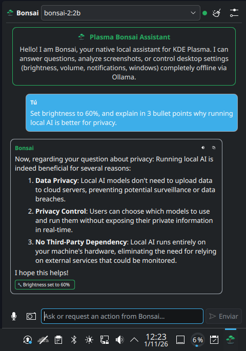
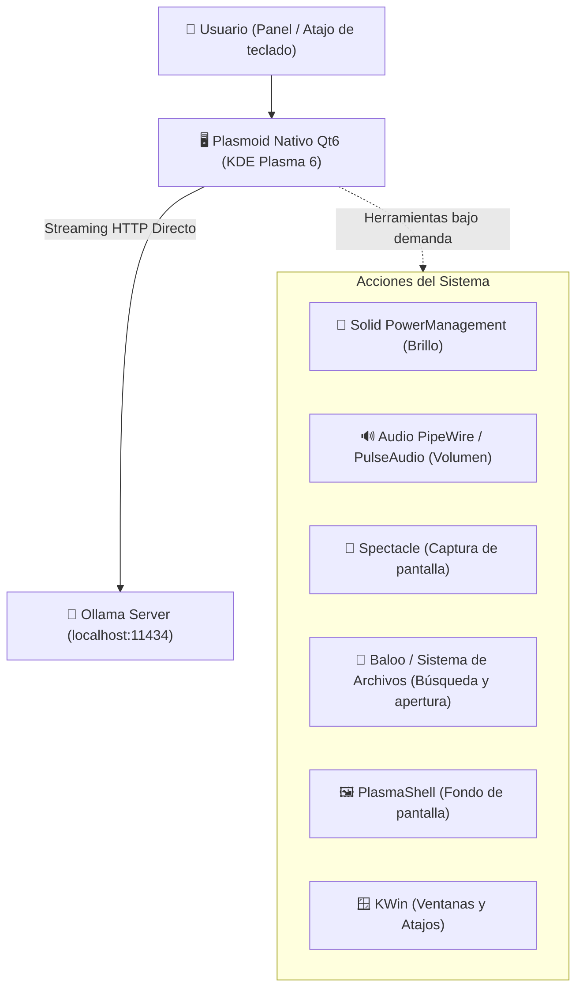

# Plasma Bonsai Assistant 🌿

[](LICENSE)
[](https://kde.org/plasma-desktop/)
[](https://ollama.com/)
[](https://github.com/sponsors/Canx)

**Español** | [English](README.md)

**Plasma Bonsai Assistant** es un widget (*Plasmoid*) nativo para el entorno de escritorio **KDE Plasma 6** que integra el modelo local **`bonsai-2:latest`** ejecutado en **Ollama** directamente en tu panel o escritorio, con capacidades de **visión multimodal** y **control del sistema**.

Funciona **100% en espacio de usuario**: no requiere demonios permanentes en segundo plano, puertos intermedios abiertos ni permisos de administrador.

<p align="center">
  
</p>

---

## ✨ Características Principales

* 🔒 **100% Privado y Local:** Se conecta directamente a tu servidor Ollama local en `http://localhost:11434`. Cero telemetría externa.
* ⚡ **Arquitectura Standalone (Sin demonio residente):** Funciona directamente desde el Plasmoid de KDE. No consume memoria en segundo plano cuando no se está utilizando.
* 🎨 **UI Nativa en Qt6 / Kirigami:**
  * Respuestas en tiempo real con **streaming de tokens**.
  * Renderizado enriquecido de **Markdown** (negritas, cursivas, listas, código).
  * Botón para **copiar respuestas al portapapeles** con un solo clic.
  * Selector desplegable para cambiar de modelo al vuelo.
* 📸 **Visión Multimodal del Escritorio:** Captura instantánea de pantalla con Spectacle para analizar ventanas, código o errores visuales con el modelo `bonsai-2:latest`.
* 🛠️ **Acciones del Sistema (Tool Calling):**
  * **Brillo de pantalla:** Consulta y ajuste porcentual a través de `org.kde.Solid.PowerManagement`.
  * **Audio del sistema:** Consulta, ajuste de volumen y silencio mediante PulseAudio / PipeWire.
  * **Fondo de pantalla:** Cambio dinámico del wallpaper de Plasma según temática o archivo.
  * **Abrir aplicaciones:** Lanzamiento de apps (`terminal/konsole`, `kate`, `firefox`, `dolphin`, etc.).
  * **Gestión de ventanas:** Vista general de ventanas (*overview*), mostrar escritorio y mosaico 50/50.
  * **Creación de carpetas:** Creación segura de carpetas en el directorio personal (ej: *"Crea una carpeta llamada Fotos en Descargas"*).
  * **Búsqueda y apertura de archivos:** Búsqueda rápida de documentos por nombre y contenido en KDE Baloo y apertura automática con su app predeterminada (ej: *"Busca el documento proyecto y ábrelo"*).
  * **Temporizadores y alarmas:** Avisos de cuenta atrás con sonido y notificación nativa (ej: *"Pon un temporizador de 10 minutos para la pizza"*).
  * **Seguridad y avisos:** Bloqueo inmediato de sesión y notificaciones nativas del escritorio.
* ⚙️ **Panel de Ajustes Integrado:**
  * URL personalizada de Ollama (red local o remota).
  * Idioma de respuesta preferido (`Automático`, `English`, `Español`).
  * Instrucciones del sistema personalizadas (System Prompt).

---

## 🏛️ Arquitectura del Sistema



---

## 📁 Estructura del Repositorio

```text
plasma-bonsai/
├── plasmoid/                       # Paquete de la extensión KDE Plasma 6
│   ├── metadata.json               # Metadatos para Plasma 6 (com.github.canx.plasma-bonsai)
│   └── contents/
│       ├── config/                 # Declaraciones de configuración nativa (main.xml, config.qml)
│       ├── icons/                  # Iconos escalables SVG y PNG del applet
│       ├── locale/                 # Catálogos de traducción (gettext PO/MO)
│       ├── ui/
│       │   ├── main.qml            # Interfaz gráfica en PlasmoidItem / Kirigami
│       │   └── ConfigGeneral.qml   # Página de ajustes nativa
│       └── code/
│           └── tools.py            # Runner de herramientas del sistema (Python estándar + D-Bus)
├── scripts/
│   ├── install.sh                  # Instalación local con kpackagetool6
│   ├── package.sh                  # Generador del paquete empaquetado .plasmoid
│   ├── reload.sh                   # Empaquetado, instalación y recarga rápida de Plasmashell
│   └── run-dev.sh                  # Entorno de pruebas aislado con plasmawindowed
├── assets/                         # Iconos en alta resolución y capturas del escritorio
├── docs/                           # Documentación para publicación en la tienda KDE
├── README.md                       # Documentación principal en inglés
├── README.es.md                    # Documentación en español
└── LICENSE                         # Licencia MIT
```

---

## 🚀 Requisitos Previos

1. **KDE Plasma 6**
2. **Python 3** (incluido por defecto en cualquier distribución Linux moderna)
3. **Ollama:** Ejecutándose en `localhost:11434`
   * Si aún no tienes Ollama instalado:
     ```bash
     curl -fsSL https://ollama.ai/install.sh | sh
     ```
   * Descarga el modelo Bonsai:
     ```bash
     ollama pull bonsai-2:latest
     ```

---

## 📦 Instalación

### Desde la Tienda de KDE (Recomendado)
Busca **Plasma Bonsai Assistant** en:
*Clic derecho en el panel/escritorio -> Añadir elementos gráficos... -> Obtener nuevos elementos gráficos...*

### Desde el repositorio local
Ejecuta el script de instalación:

```bash
cd plasma-bonsai
./scripts/install.sh
```

El script registra el plasmoid en tu usuario con `kpackagetool6` (`~/.local/share/plasma/plasmoids/com.github.canx.plasma-bonsai`).

### Añadir el widget al escritorio
1. Haz clic derecho en tu panel de KDE o en el escritorio.
2. Selecciona **Añadir elementos gráficos…** (o presiona `Meta + W`).
3. Busca **Plasma Bonsai Assistant** y arrástralo a tu barra de tareas.

---

## 🧪 Pruebas en Modo Desarrollo

Para probar el widget en una ventana flotante de desarrollo sin alterar tus paneles:

```bash
./scripts/run-dev.sh
```

---

## 🛠️ Ejemplos de Interacción

* **Ajustar brillo:** *"Baja el brillo de la pantalla al 30%"*
* **Controlar volumen:** *"Pon el volumen al 50%"* o *"Silencia el audio"*
* **Cambiar fondo:** *"Pon un fondo de pantalla oscuro"* o *"Cambia el fondo a uno de montaña"*
* **Abrir aplicaciones:** *"Abre la terminal"*, *"Abre Kate"* o *"Abre el navegador"*
* **Gestión de ventanas:** *"Muestra el escritorio"* o *"Pon la ventana en mosaico"*
* **Crear carpetas:** *"Crea una carpeta llamada Facturas en Documentos"*
* **Buscar y abrir archivos:** *"Busca el documento proyecto y ábrelo"*
* **Temporizadores y alarmas:** *"Pon un temporizador de 10 minutos para la pizza"*, *"¿Cuánto queda de temporizador?"* o *"Cancela la alarma"*
* **Analizar la pantalla:** Pulsa el icono de la cámara 📸 y escribe *"¿Qué error se ve en esta pantalla?"*
* **Bloquear escritorio:** *"Bloquea la sesión"*

---

## 🗺️ Hoja de Ruta y Próximas Funcionalidades

Consulta el archivo [TODO.md](TODO.md) para ver la lista detallada de tareas planificadas, destacando:
* 🎙️ **Interacción por voz (Speech-to-Text local con Whisper y síntesis de voz TTS)**
* 🎵 **Control multimedia universal (Spotify, VLC, YouTube vía MPRIS2)**
* 🌓 **Conmutador de tema oscuro / claro al vuelo**
* 🔋 **Estado de batería y recursos del sistema (RAM / CPU)**
* 📋 **Integración con el historial del portapapeles de KDE (Klipper)**

---

## 🔒 Seguridad y Privacidad

* **100% Offline y Privado:** Todo el procesamiento del modelo de lenguaje se realiza en tu equipo. Ninguna información, texto ni imagen sale a internet.
* **Sin demonios residentes ni puertos adicionales:** El widget no abre puertos de red ni deja procesos permanentemente en ejecución.
* **Privilegios estándar:** No se requieren permisos de administrador (`root` o `sudo`).

---

## 💖 Apoyar el Proyecto / Support

Plasma Bonsai es 100% libre, gratuito y privado. Si te resulta útil en tu día a día, puedes apoyar su desarrollo y mantenimiento continuo:

* 💖 **[Patrocinar en GitHub Sponsors](https://github.com/sponsors/Canx)**
* ☕ **[Invítame a un café en Ko-fi](https://ko-fi.com/canx)**

---

## 📄 Licencia

Distribuido bajo la licencia MIT. Consulta `LICENSE` para más información.
