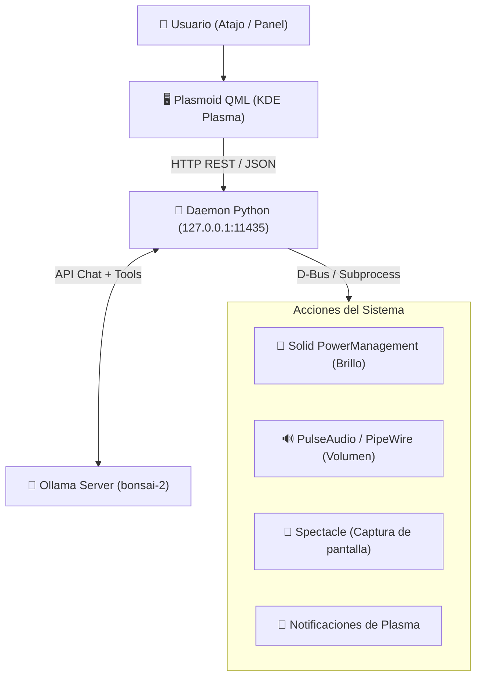

# Plasma Bonsai Assistant 🌿

[](LICENSE)
[](https://kde.org/plasma-desktop/)
[](https://ollama.com/)

**Plasma Bonsai Assistant** es un widget (*Plasmoid*) nativo para el entorno de escritorio **KDE Plasma** que integra modelos de lenguaje locales ejecutados en **Ollama** (como `bonsai-2`, `qwen3.8`, `gemma4`) con las capacidades del sistema a través de **D-Bus** y visión multimodal del escritorio.

---

## ✨ Características Principales

* 🔒 **100% Privado y Local:** Funciona contra tu servidor Ollama local en `localhost:11434`. Cero telemetría externa.
* ⚡ **Integración Nativa con KDE:** Plasmoid escrito en QML / Kirigami, listo para anclarse a cualquier panel de Plasma o flotar en el escritorio.
* 🛠️ **Tool Calling por D-Bus:** El modelo puede ejecutar acciones reales en tu sesión de KDE mediante llamadas a funciones:
  * **Fondo de pantalla:** Cambio dinámico mediante el motor de script de Plasma (`change_wallpaper`).
  * **Brillo de pantalla:** Consulta y ajuste porcentual a través de `org.kde.Solid.PowerManagement`.
  * **Audio del sistema:** Consulta, ajuste de volumen y mute usando PulseAudio / PipeWire.
  * **Bloqueo de sesión:** Bloqueo seguro inmediato vía `org.freedesktop.ScreenSaver`.
  * **Notificaciones del escritorio:** Avisos nativos mediante `notify-send`.
* 📸 **Visión Multimodal del Escritorio:** Captura instantánea de pantalla o ventana activa con Spectacle para analizar errores visuales, código o interfaces con modelos multimodales.
* 🔄 **Demonio de Usuario Systemd:** Servicio ligero en segundo plano en Python que no congela la interfaz de Plasma durante la inferencia.

---

## 🏛️ Arquitectura del Sistema



---

## 📁 Estructura del Repositorio

```text
plasma-bonsai/
├── plasmoid/                       # Paquete de la extensión KDE Plasma
│   ├── metadata.json               # Metadatos para Plasma 5 y 6
│   ├── metadata.desktop            # Compatibilidad adicional Plasma 5
│   └── contents/
│       └── ui/
│           └── main.qml            # Interfaz gráfica en QML / Kirigami
├── daemon/                         # Demonio backend en Python
│   ├── server.py                   # Servidor HTTP local con gestión de chat y tools
│   ├── tools.py                    # Implementación de herramientas D-Bus y sistema
│   └── plasma-bonsai.service       # Unidad de servicio systemd de usuario
├── scripts/
│   ├── install.sh                  # Script de instalación y registro del plasmoid
│   └── run-dev.sh                  # Entorno de pruebas con plasmawindowed
├── especificaci_n_t_cnica...md    # Especificación técnica base
├── README.md                       # Documentación principal
└── LICENSE                         # Licencia MIT
```

---

## 🚀 Requisitos Previos

1. **KDE Plasma 5.27+** o **Plasma 6**.
2. **Python 3.10+** con librerías `python3-dbus` y `python3-requests`.
3. **Ollama** ejecutándose localmente con el modelo `bonsai-2:latest`:
   ```bash
   ollama run bonsai-2:latest
   ```

---

## 📦 Instalación

Ejecuta el script de instalación automática:

```bash
cd plasma-bonsai
./scripts/install.sh
```

El script se encarga de:
1. Instalar el Plasmoid en tu directorio local (`~/.local/share/plasma/plasmoids/org.kde.plasma.bonsai`).
2. Configurar y habilitar el servicio de usuario en Systemd (`plasma-bonsai.service`).

Una vez instalado, haz clic derecho en tu panel de KDE, selecciona **Añadir elementos gráficos...** y busca **Plasma Bonsai Assistant**.

---

## 🧪 Pruebas en Modo Desarrollo

Para probar el widget en una ventana aislada sin alterar tus paneles actuales:

```bash
./scripts/run-dev.sh
```

---

## 🛠️ Ejemplos de Interacción

* **Cambiar fondo de pantalla:** *"Cambia el fondo de pantalla por uno del espacio"* o *"Ponme un fondo oscuro"*
* **Ajustar brillo:** *"Baja el brillo de la pantalla al 30%"*
* **Controlar volumen:** *"Pon el volumen al 50%"* o *"Silencia el sonido"*
* **Analizar la pantalla:** Pulsa el icono de la cámara 📸 y escribe *"¿Qué error se ve en la pantalla?"*
* **Bloquear sesión:** *"Bloquea el escritorio"*

---

## 🔒 Seguridad y Privacidad

* **100% Offline y Privado:** Todo el procesamiento del LLM se ejecuta en local mediante Ollama en `localhost:11434`. Ningún dato, texto ni captura de pantalla sale de tu ordenador.
* **Aislamiento en Localhost:** El demonio backend en Python escucha exclusivamente en la interfaz de bucle invertido (`127.0.0.1:11435`), sin exposición a la red local ni a internet.
* **Privilegios de Usuario:** El servicio corre como servicio de usuario en systemd (`systemctl --user`), sin necesidad de privilegios `root` o `sudo`.
* **Herramientas acotadas por lista blanca:** El LLM no tiene acceso a ejecución arbitraria de comandos (`bash` o `eval`). Solo puede invocar las funciones explícitamente declaradas en su esquema (brillo, volumen, fondo, captura, bloqueo y notificación).

---

## 📄 Licencia

Distribuido bajo la licencia MIT. Consulta `LICENSE` para más información.
