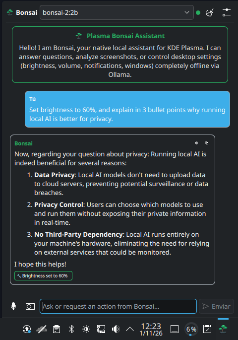
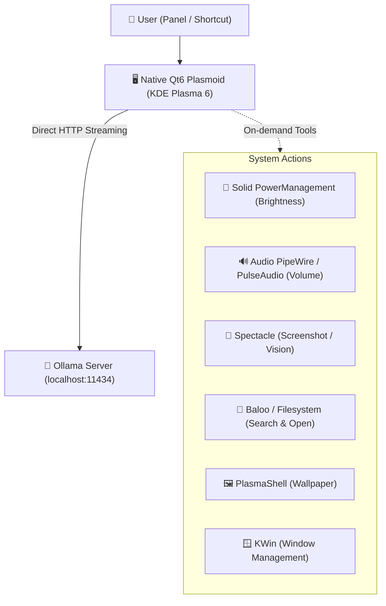

# Plasma Bonsai Assistant 🌿

[](LICENSE)
[](https://kde.org/plasma-desktop/)
[](https://ollama.com/)
[](https://github.com/sponsors/Canx)

[Español](README.es.md) | **English**

**Plasma Bonsai Assistant** is a native widget (*Plasmoid*) for **KDE Plasma 6** that integrates the **`bonsai-2:latest`** local model powered by **Ollama** directly into your desktop panel or desktop view, featuring **multimodal desktop vision**, **bilingual localization**, and **natural language system actions**.

Built **100% in user space**: no persistent resident background daemons, no intermediate open network ports, and no root permissions required.

<p align="center">
  
</p>

---

## ✨ Key Features

* 🔒 **100% Private & Local:** Directly connects to your local Ollama server at `http://localhost:11434`. Zero telemetry, zero tracking, no cloud dependencies or API keys.
* ⚡ **Standalone & Daemonless Architecture:** Runs purely within the KDE Plasmoid environment. Consumes zero RAM when not in use.
* 🎨 **Native Qt6 / Kirigami UI:**
  * Real-time token streaming with animated typing indicator.
  * Rich **Markdown** rendering (headers, bold, italics, lists, code blocks).
  * Quick **copy-to-clipboard** button on assistant messages.
  * Dropdown selector to switch between local Ollama models on the fly.
* 📸 **Multimodal Desktop Vision:** Integrated screenshot tool using Spectacle to analyze windows, code snippets, or error dialogs with vision-capable models (`bonsai-2:latest`).
* 🛠️ **System Control & Actions (Tool Calling):**
  * **Screen Brightness:** Query and adjust exact percentage via `org.kde.Solid.PowerManagement`.
  * **Audio Control:** Query, adjust volume, and mute/unmute via PipeWire / PulseAudio.
  * **Wallpaper:** Change Plasma wallpaper on demand by theme or specific filename.
  * **Launch Applications:** Open apps (`terminal/konsole`, `kate`, `firefox`, `dolphin`, etc.).
  * **Window Management:** Toggle desktop view, overview, or 50/50 window tiling.
  * **Safe Directory Creation:** Create folders safely inside `$HOME` (e.g., *"Create a folder named Project in Documents"*).
  * **Document Search & Open:** Fast file/document search with native **KDE Baloo** and automatic document opening with default applications (e.g., *"Find the invoice PDF and open it"*).
  * **Attach & Inspect Local Files:** Paperclip button 📎 to attach and analyze documents (PDFs, code files, `.txt`, `.md`, `.json`, `.csv`, `.log`) or images with multimodal vision.
  * **Direct Document Reading:** Assistant capability to read and summarize files directly from disk (`read_file_content`).
  * **Clipboard & History:** Inspect copied text, view Klipper history, and copy new text to clipboard.
  * **Timers & Alarms:** Countdown alarms with sound and native Plasma notifications (e.g., *"Set a 10 minute pizza timer"*).
  * **Security & Lock:** Instantly lock the desktop session.
* ⚙️ **Integrated In-Widget Settings:**
  * Custom Ollama server URL (supports local or LAN/remote instances).
  * Response language preference (`Auto`, `English`, `Español`).
  * Custom Instructions (System Prompt).

---

## 🏛️ Architecture



---

## 📁 Repository Structure

```text
plasma-bonsai/
├── plasmoid/                       # KDE Plasma 6 applet package
│   ├── metadata.json               # Plasma 6 metadata (com.github.canx.plasma-bonsai)
│   └── contents/
│       ├── config/                 # Plasma config declarations (main.xml, config.qml)
│       ├── icons/                  # Scalable SVG & PNG applet icons
│       ├── locale/                 # Translation catalogs (gettext PO/MO)
│       ├── ui/
│       │   ├── main.qml            # Main Kirigami user interface
│       │   └── ConfigGeneral.qml   # Native settings page
│       └── code/
│           └── tools.py            # Standard Python + D-Bus system tool runner
├── scripts/
│   ├── install.sh                  # Local installation with kpackagetool6
│   ├── package.sh                  # Builds standalone .plasmoid package
│   ├── reload.sh                   # Builds, installs, and reloads Plasmashell
│   └── run-dev.sh                  # Isolated test environment with plasmawindowed
├── assets/                         # High-res icons and desktop screenshots
├── docs/                           # Store listings and publishing documentation
├── README.md                       # Main documentation (English)
├── README.es.md                    # Documentación en Español
└── LICENSE                         # MIT License
```

---

## 🚀 Requirements

1. **KDE Plasma 6**
2. **Python 3** (included in all modern Linux distributions)
3. **Ollama:** Running locally on `http://localhost:11434`
   * If you don't have Ollama installed yet:
     ```bash
     curl -fsSL https://ollama.ai/install.sh | sh
     ```
   * Pull the Bonsai model:
     ```bash
     ollama pull bonsai-2:latest
     ```

---

## 📦 Installation

### Option 1: Via KDE Store (Recommended)
Search for **Plasma Bonsai Assistant** in:
*Right-click Desktop/Panel -> Add Widgets... -> Get New Widgets...*

### Option 2: From Local Repository
Run the installation script:

```bash
cd plasma-bonsai
./scripts/install.sh
```

The script registers the plasmoid in user space with `kpackagetool6` (`~/.local/share/plasma/plasmoids/com.github.canx.plasma-bonsai`).

### Adding the Widget to Your Panel:
1. Right-click your KDE panel or desktop.
2. Select **Add Widgets...** (or press `Meta + W`).
3. Search for **Plasma Bonsai Assistant** and drag it to your panel.

---

## 🧪 Development & Testing

To test the widget inside an isolated floating development window without modifying your desktop panels:

```bash
./scripts/run-dev.sh
```

---

## 🛠️ Example Prompts

* **Brightness:** *"Lower screen brightness to 30%"*
* **Volume:** *"Set volume to 50%"* or *"Mute audio"*
* **Wallpaper:** *"Set a dark wallpaper"* or *"Change wallpaper to mountain theme"*
* **Launch Applications:** *"Open terminal"*, *"Open Kate"*, or *"Launch web browser"*
* **Window Management:** *"Show desktop"* or *"Tile windows 50/50"*
* **File Operations:** *"Create a folder named Invoices in Documents"*
* **Search & Open:** *"Find document report.pdf and open it"*
* **Attach & Read Documents:** Click the paperclip 📎 to attach a PDF or source code file, or ask *"Read 'report.pdf' and summarize it"*
* **Clipboard:** *"What is in my clipboard?"*, *"Clipboard history"*, or *"Copy this text to clipboard"*
* **Timers:** *"Set a 10 minute pizza timer"*, *"How much time is left?"*, or *"Cancel the timer"*
* **Desktop Vision:** Click the camera icon 📸 and ask *"What error is shown in this window?"*
* **Security:** *"Lock the screen"*

---

## 🗺️ Roadmap & Upcoming Features

See [TODO.md](TODO.md) for the planned features roadmap, including:
* 🎙️ **Voice interaction (Offline Speech-to-Text with Whisper & Piper TTS)**
* 🎵 **Universal media player control (Spotify, VLC, YouTube via MPRIS2)**
* 🌓 **Quick dark/light color scheme switcher**
* 🔋 **Hardware & battery status queries**
* 📋 **Klipper clipboard history integration**

---

## 🔒 Security & Privacy

* **100% Offline & Private:** All LLM inference runs directly on your machine. No text, prompts, or images leave your local network.
* **No Resident Background Daemons:** The widget does not open background network listener ports or keep idle memory-hogging processes running.
* **Standard Permissions:** No administrative (`root` or `sudo`) privileges required.

---

## 💖 Support the Project

Plasma Bonsai is 100% free, private, and open-source. If you find it useful, consider supporting its development:

* 💖 **[Sponsor on GitHub Sponsors](https://github.com/sponsors/Canx)**
* ☕ **[Buy me a coffee on Ko-fi](https://ko-fi.com/canx)**

---

## 📄 License

Distributed under the MIT License. See `LICENSE` for details.
